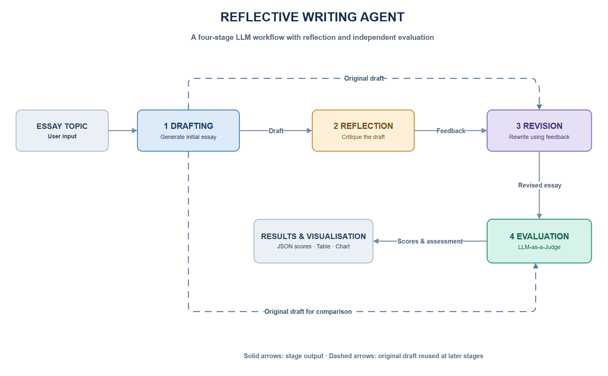
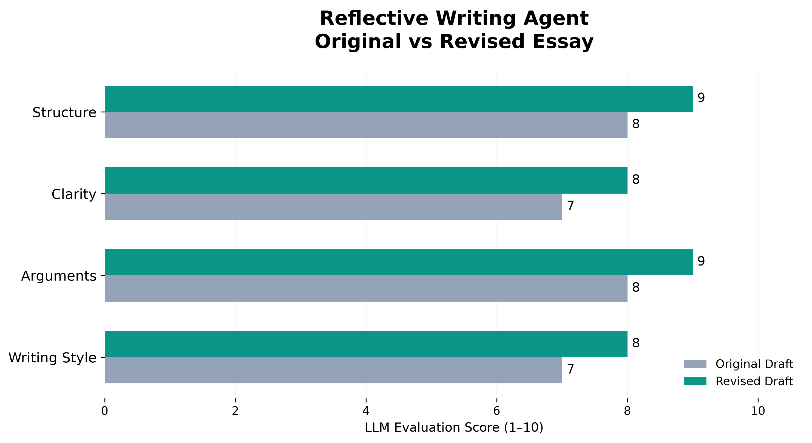

# Reflective Writing Agent

### An Agentic AI Workflow for Iterative Essay Improvement

A Python-based agentic AI project demonstrating how Large Language Models (LLMs) can generate, critique, revise and evaluate written content through a structured reflection workflow.

The project uses the **OpenAI API** and implements four distinct LLM-based stages, combining the **Reflection design pattern** with **LLM-as-a-Judge evaluation**.

## Workflow Architecture



The workflow consists of four stages:

1. **Draft Generation:** Generates an initial essay based on a user-defined topic.
2. **Reflection:** Critically evaluates the draft and identifies opportunities for improvement.
3. **Revision:** Produces a revised essay using the reflection feedback.
4. **Evaluation:** Compares the original and revised essays using predefined writing quality criteria.

The original draft is retained and reused during revision and evaluation.

## Technologies

- Python 3.12
- OpenAI API (`gpt-4o-mini`)
- Jupyter Notebook
- Pandas and NumPy
- Matplotlib
- python-dotenv

## Evaluation Results

The Evaluation Agent assesses both essays across four criteria:

- Structure and organisation
- Clarity and coherence
- Strength of arguments
- Writing style and readability

### Example Results

For the essay topic *"Should social media platforms be regulated by the government?"*, the LLM evaluator produced the following scores:

| Criterion | Original Draft | Revised Draft |
|---|---:|---:|
| Structure | 8 | 9 |
| Clarity | 7 | 8 |
| Arguments | 8 | 9 |
| Writing Style | 7 | 8 |
| **Average** | **7.5** | **8.5** |



The revised essay received higher scores across all four criteria.

**Note:** These scores represent subjective LLM assessments rather than independently validated measures of writing quality.

## Project Structure

```text
Reflective-Writing-Agent/
├── images/
│   ├── workflow_architecture.png
│   └── essay_evaluation.png
├── agents.py
├── main.py
├── visualise.py
├── reflective_writing_demo.ipynb
├── test_connection.py
├── requirements.txt
├── .gitignore
└── README.md
```

## Installation

Clone the repository and navigate to the project directory:

```bash
git clone https://github.com/sulimanYB/Reflective-Writing-Agent.git
cd Reflective-Writing-Agent
```

Create a Python environment:

```bash
conda create -n reflective-writing python=3.12 -y
conda activate reflective-writing
```

Install the dependencies:

```bash
python -m pip install -r requirements.txt
```

Create a `.env` file in the project root and add your OpenAI API key:

```dotenv
OPENAI_API_KEY=your_api_key_here
```

The `.env` file is excluded from Git version control.

## Usage

### Run as a Python application

```bash
python main.py
```

This executes the complete Draft → Reflect → Revise → Evaluate workflow and displays the evaluation chart.

### Run interactively in Jupyter

Open `reflective_writing_demo.ipynb` in VS Code or Jupyter and execute the cells sequentially.

The notebook includes explanations, generated essays, reflection feedback, evaluation results and visualisations.

**API usage:** Each complete workflow execution makes four billable OpenAI API requests.

## Limitations

This implementation demonstrates a single reflection–revision cycle rather than an autonomous iterative loop.

The evaluation relies on LLM-generated judgements, which may vary across runs and may exhibit model-specific biases.

The workflow does not independently verify factual statements or supporting evidence in generated essays.

## Future Improvements

Potential extensions include:

- Iterative reflection with quality-based stopping criteria.
- Comparing different LLMs for reflection and evaluation.
- Human-in-the-loop review.
- Evaluating multiple writing topics and measuring score variability.
- Factual verification using external sources.
- Tracking API token usage, execution time and cost.

## Acknowledgement

This project was inspired by the Reflection workflow explored in DeepLearning.AI's Agentic AI course and extended into a modular Python implementation with structured evaluation and visualisation.